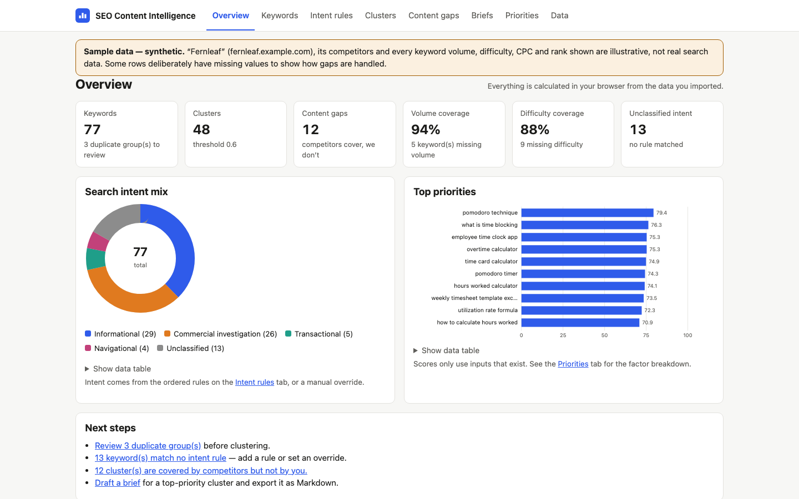

# SEO Content Intelligence Toolkit

Turn a keyword-research CSV into **search-intent clusters, content gaps, editable content briefs and explainable
priorities**, without inventing numbers. When volume, difficulty or competitor data is missing, the tool says
*missing input* and leaves that factor out. It never estimates a value.

**Live demo:** https://dash-boop0.github.io/seo-content-intelligence/
**Source:** https://github.com/Dash-boop0/seo-content-intelligence



> The screenshot and the bundled sample use **synthetic data** for a fictional site ("Fernleaf",
> `fernleaf.example.com`). Volumes, difficulty, CPC and ranks are illustrative, not real search data.

## Why

Keyword exports are long, messy lists. Turning them into a content plan means de-duplicating, judging intent,
grouping related terms, checking what competitors already cover and deciding what to write first. Every one of
those steps should be **explainable** to a stakeholder. This toolkit does each step with transparent, editable,
deterministic logic, and shows its reasoning next to every result.

## Features

- **CSV import with column mapping.** Headers are auto-matched (e.g. *Search Term*, *Avg. Monthly Searches*, *KD*,
  *Position*) and you can re-map them. Only the keyword column is required. `12,100`, `1.2k`, `$4.20` and `45%`
  are parsed. Invalid cells become *missing* and are listed row by row in an import report. The CSV parser follows
  RFC 4180 (quotes, embedded commas and newlines, BOM, CRLF).
- **Normalisation and de-duplication.** Lowercase, trim, collapse whitespace, strip punctuation and diacritics, with
  optional simple plural folding. Exact duplicates (same normalised text) and near duplicates (same word set in any
  order, plurals folded) are shown with the reason they matched. You merge them one at a time or all at once.
- **Intent classification by ordered, editable rules.** Informational, commercial investigation, transactional or
  navigational. The first enabled rule that matches wins. Each keyword shows *"Rule #3: contains 'best'"*, and a
  keyword no rule matches shows **Unclassified**. Includes a live rule tester and per-keyword overrides.
- **Explainable clustering.** Core terms (stopwords and modifiers removed) are compared to a seed keyword using
  **Jaccard similarity**, with an adjustable threshold. Every member shows its similarity and shared terms.
- **Competitor content gaps.** Import competitor coverage and your own pages. Each cluster is labelled Gap, Contested,
  Ours only or Untapped. Competitor topics that aren't in your research are listed with volume as *missing input*.
- **Editable briefs.** Each brief has audience, intent, working title, an H2/H3 outline, questions taken from
  question-form keywords, internal-link opportunities from your pages that share terms, and data notes. Export one
  brief or all of them as **Markdown**.
- **Prioritisation.** A weighted 0–100 score per cluster from up to five factors: demand, ease, intent value,
  competitor gap and rank opportunity. Missing factors are **excluded and listed**, an *input coverage* percentage
  shows how much of the score is backed by data, and weights and intent values are editable. Export as **CSV** or
  **Markdown**.
- **Charts and persistence.** Hand-drawn SVG charts (intent donut, priority bars, score-contribution stacked bars,
  competitor coverage) each come with a data table. Data is stored in browser localStorage and supports JSON
  backup/restore, sample data and reset.
- **No dependencies.** No frameworks, CDNs, API keys, trackers or network calls. Responsive down to 375px, with
  light and dark mode.

## Quick start

You only need Python 3 (macOS usually has it) or Node.js. There is nothing to install.

**macOS / Linux**
```bash
git clone https://github.com/Dash-boop0/seo-content-intelligence.git
cd seo-content-intelligence
python3 -m http.server 8000      # or: npx serve .
# open http://localhost:8000
```

**Windows (PowerShell)**
```powershell
git clone https://github.com/Dash-boop0/seo-content-intelligence.git
cd seo-content-intelligence
py -m http.server 8000           # or: npx serve .
# open http://localhost:8000
```

Opening `index.html` directly as a `file://` page will not work: browsers block ES modules and the sample-data
fetch from `file://`. Use a local server as shown above.

## How to use

1. **Load sample data**, or go to **Keywords** and import your CSV (file or pasted text). Check the column
   mapping and import.
2. **Keywords**: review duplicate groups and merge them, filter rows with missing inputs, fill in or correct values
   inline, and override intent where the rules are wrong.
3. **Intent rules**: test keywords, then edit, reorder, disable or add rules. Intents recalculate immediately.
4. **Clusters**: adjust the similarity threshold and expand a cluster to see why each keyword is in it.
5. **Content gaps**: import `competitors` and `our pages` CSVs (templates are in `sample-data/`) and filter to gaps.
6. **Briefs**: pick a cluster, click **Generate brief**, edit any field (it saves automatically) and export to Markdown.
7. **Priorities**: adjust the weights and intent values, then read the factor breakdown and export recommendations.
8. **Data**: back up, restore, reload the sample, or reset.

The full walkthrough is in [docs/DEMO.md](docs/DEMO.md).

## Scoring (summary)

```
score    = 100 × Σ(weight × factor) ÷ Σ(weights of factors that have data)
coverage = Σ(weights of factors with data) ÷ Σ(all weights)
```

| Factor (default weight) | 0–1 value | Missing when |
|---|---|---|
| Search demand (30) | log10(1 + cluster volume) ÷ log10(1 + largest cluster volume) | no volume in cluster |
| Ease (25) | 1 − average difficulty ÷ 100 | no difficulty in cluster |
| Intent value (20) | transactional 1.0 · commercial 0.8 · informational 0.5 · navigational 0.2 (editable) | all unclassified |
| Competitor gap (15) | gap 1.0 · untapped 0.6 · contested 0.4 · ours only 0.1 | no competitor CSV |
| Rank opportunity (10) | best rank 1–3: 0.1 · 4–10: 1.0 · 11–20: 0.8 · 21–50: 0.5 · 51+: 0.3 | no rank data |

If no factor has data, the score is **n/a**, never 0. The full definitions and a worked example (76.1 and 74.7,
both checked by the tests) are in **[docs/SCORING.md](docs/SCORING.md)**. The intent rules are documented in
**[docs/INTENT_RULES.md](docs/INTENT_RULES.md)**. Normalisation, de-duplication, clustering, gap and brief logic is
documented in **[docs/METHOD.md](docs/METHOD.md)**.

## Data model and architecture

The state lives in localStorage (keywords, rules, settings, competitor rows, pages, briefs). Intents, clusters,
gaps and scores are recomputed from it, never stored. See [docs/ARCHITECTURE.md](docs/ARCHITECTURE.md) for the
Mermaid diagram and the full schema.

```
index.html            app shell
src/app.js            UI: rendering, events, persistence
src/styles.css        design tokens, light/dark
src/lib/              pure logic (no DOM), tested in Node:
  csv.js importer.js normalize.js intent.js cluster.js gap.js score.js brief.js pipeline.js state.js charts.js
sample-data/          synthetic sample CSVs + empty templates (see sample-data/README.md)
tests/                node:test suites
docs/                 SCORING, INTENT_RULES, METHOD, ARCHITECTURE, DEMO, screenshot
```

## Sample data

`sample-data/` contains a **synthetic** dataset with 77 keywords, 19 competitor topics across 3 fictional
competitors, and 10 pages for the fictional site Fernleaf. Some rows deliberately lack volume or difficulty, and a
few are deliberate duplicates. **The numbers are illustrative and do not come from any SEO tool.** The app shows a
banner whenever the sample is loaded. Details are in [sample-data/README.md](sample-data/README.md).

## Tests

```bash
npm test          # runs: node --test   (Node 18+; no dependencies to install)
```

There are 62 tests. They cover CSV parsing and serialisation (including injection protection), normalisation and
plural folding, exact and near-duplicate detection and merging, column mapping and value validation, intent rules
(order, match types, invalid regex, overrides), clustering with hand-computed Jaccard cases, gap statuses, every
scoring factor plus the documented worked example, brief generation and Markdown, backup validation, and an
end-to-end run on the sample CSVs.

## Limitations

- **No live data.** The tool does not fetch search volumes, SERPs, rankings or competitor pages. It analyses only what
  you import. "Untapped" means nobody *in your competitor file* covers a topic, not nobody on the web.
- **Lexical, not semantic.** Intent rules and clustering compare words, not meaning. Synonyms ("timesheet" vs "time
  card") are not grouped, and plural folding is deliberately simple; it is not a stemmer.
- **Seed-based clustering is order-dependent.** It is deterministic, but the highest-volume keyword becomes the seed,
  so changing volumes can reshape clusters. Cluster sizes depend heavily on the threshold.
- **Relative volume scaling.** The demand factor is relative to the largest cluster in the current dataset, so scores
  are comparable within one dataset, not across datasets.
- **Judgement values.** The gap and rank factor tables are documented heuristics. The weights are editable; those
  two tables are not.
- **Browser storage only.** Data lives in one browser's localStorage. Use the JSON backup to move or keep it. There
  are no accounts or collaboration.
- Briefs are structured starting points generated from templates, not written content.

## License

MIT. See [LICENSE](LICENSE).

## Repository details

- **Description:** Turn keyword CSVs into intent clusters, content gaps, editable briefs and explainable SEO priorities.
- **Topics:** `seo`, `content-strategy`, `keyword-research`, `search-intent`, `keyword-clustering`, `content-gap-analysis`, `vanilla-js`, `static-site`
- **Profile README line:** *SEO Content Intelligence Toolkit: turns keyword research into intent clusters, competitor
  gaps, editable briefs and explainable priorities, and flags missing data instead of inventing it.*
