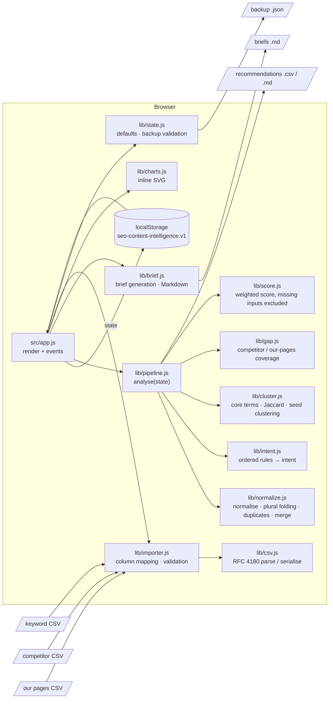

# Architecture

A static, dependency-free single-page app. There is no server, build step, database or network call beyond
loading the app's own files (and the bundled sample CSVs when you click "Load sample data").



## Layers

| Layer | Files | Notes |
|---|---|---|
| Shell | `index.html`, `src/styles.css` | Design tokens on `:root`, dark mode via `prefers-color-scheme`. |
| UI | `src/app.js` | Hash routing (`#keywords`, …), event delegation via `data-action` / `data-change` / `data-input`, all user text escaped. Recomputes the analysis after every change (cached until the next change). |
| Logic | `src/lib/*.js` | Pure ES modules, no DOM access, imported unchanged by Node tests. |
| Data | `sample-data/*.csv` | Synthetic sample + empty templates. |
| Tests | `tests/*.test.js` | `node --test`, no dependencies. |

## Data model (localStorage, key `seo-content-intelligence.v1`)

```js
{
  version: 1,
  isSample: boolean,                 // drives the "synthetic data" banner
  nextId: number,
  keywords: [{ id, keyword, volume|null, difficulty|null, cpc|null, rank|null, url, intentOverride|null,
               mergedFrom: [{ keyword, volume, difficulty }] }],
  rules: [{ id, enabled, intent, match: 'contains'|'starts'|'ends'|'regex', terms, note }],
  settings: { foldPlurals, clusterThreshold, weights: { volume, difficulty, intent, gap, rank },
              intentValues: { transactional, commercial, informational, navigational } },
  competitors: [{ domain, url, topic }],
  ourPages: [{ url, title, topic }],
  briefs: { [clusterId]: { clusterId, primaryKeyword, intent, workingTitle, audience, secondaryKeywords,
                           outline, questions, internalLinks, dataNotes, notes, updatedAt } },
  dismissedDuplicates: [groupKey]
}
```

Derived data (intents, duplicate groups, clusters, gaps, summaries, scores) is never stored; it is recomputed
from the state by `analyse()` so it can't drift out of sync. Cluster ids are `c:<normalised seed keyword>`, which
keeps saved briefs attached while the seed stays the same; briefs whose cluster disappears (e.g. after changing
the threshold) are kept and flagged.

## Error handling

- CSV parse errors (e.g. an unclosed quote) report the line number; missing required columns list the expected headers.
- Invalid cell values become missing and appear in the import report.
- Backups are validated (`validateState`) before replacing data; malformed saved data is ignored with a message.
- localStorage failures (private mode, quota) show a warning and the app keeps working in memory.
- A rendering error shows an explanatory panel instead of a blank page.
